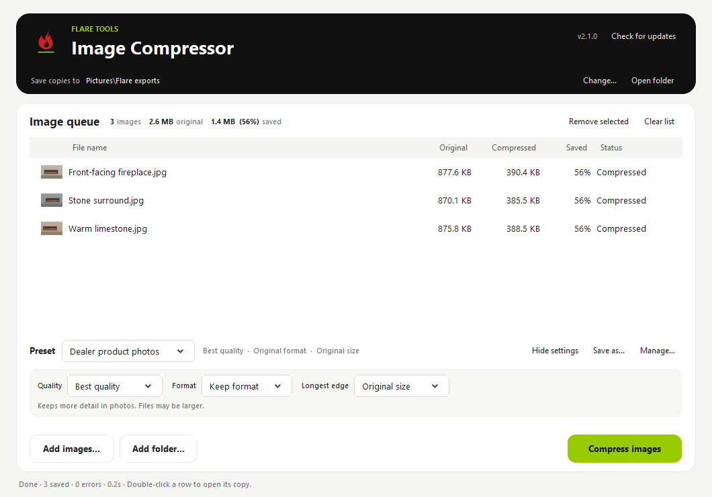

# Flare Tools · Image Compressor

Compress a folder of images on your Windows PC and keep the originals.
Run **Flare-Image-Compressor-Setup-2.1.0.exe** to install or upgrade.
Open **Image Compressor** from the **Flare Tools** Start menu folder.
Installation works with a standard Windows account and includes Python.



## Compress a batch

1. Drop images or a folder into the queue, or choose **Add images…** or **Add folder…**.
2. Choose a preset. **Everyday** keeps original dimensions and format for JPEG, PNG and WebP.
3. Check **Save copies to**, then choose **Compress images**. Choose **Open folder** to see the copies.

The default destination is **Flare Compressed Images** on your desktop.
The app remembers a different destination when you choose one. Files with
matching names receive numbered copies.

## Save settings for different images

| Starting preset | Quality | Output | Maximum long edge |
| --- | --- | --- | --- |
| Everyday | Balanced | Keep format | Original size |
| Product photos | Best quality | Keep format | Original size |
| Website images | Balanced | WebP | 1920 px |
| Email attachments | Smallest | Keep format | 1280 px |

Choose the closest preset and open **Edit settings**. Adjust the quality,
output format or size, then choose **Save as…** and enter a name. For example,
save **Dealer portal** for a WebP export with a 1280 px limit. Select that
name under **Preset** to apply all three settings to another batch.
Choose **Manage…** to rename or delete a preset, or choose **Use current
settings** to replace its saved values with the settings on screen.

The app restores the last selection or custom settings when you reopen it.
Your output folder applies across presets. Upgrades from 2.0.1 also pick up
your previous quality, format and size choices.

## Image handling

| Quality | JPEG / WebP quality | PNG at original size |
| --- | --- | --- |
| Balanced | 82 | Preserves pixel values |
| Best quality | 92 | Preserves pixel values |
| Smallest | 68 | May reduce color detail, preserves transparency |

JPEG and WebP encoding is lossy. When keeping both format and size, the app
copies the original file if re-encoding would make it larger. Re-encoded
images retain the color profile and apply EXIF orientation, then omit EXIF
and ancillary metadata. Exact copies retain their original metadata.

With **Keep format**, BMP and single-page TIFF become PNG. Animated,
multipage and over-50-megapixel images are skipped with a reason. Resizing
keeps proportions and never enlarges an image.

Add up to 10,000 images. The queue loads thumbnails as rows come into view.
Two background workers process the batch. Canceling
stops pending work and keeps completed copies. Select a row for details.
Double-click to preview an unprocessed image or open a completed copy.
Removing rows or clearing the queue leaves files on disk.

| Keyboard shortcut | Action |
| --- | --- |
| Ctrl+O | Add images |
| Ctrl+Shift+O | Add a folder |
| Delete | Remove selected images from the queue |
| Ctrl+Enter | Compress the queue |
| Esc | Cancel the batch |

## Updates and local data

Compression works offline. The app checks GitHub for updates daily when
opened. You can also choose **Check for updates**. The app verifies the
downloaded installer's SHA-256 checksum before launching it.
This release is unsigned, so Windows may show a publisher prompt.

Preferences, presets and logs are in
`%LOCALAPPDATA%\Flare Tools\Image Compressor`. Uninstalling leaves images
and preferences in place.

## Portable edition and source

Extract the portable ZIP and run **FlareImageCompressor.exe**. Keep the
accompanying **_internal** folder beside it. The portable and installed
editions use the same preferences for your Windows account.

The source ZIP includes the application, tests, suite assets, design notes
and build files. Use Python 3.13 x64 and Inno Setup 6 to rebuild from source.

```powershell
python -m pip install -r requirements.txt
python make_assets.py
python -m unittest discover -s tests -v
python tests/ui_smoke.py
python tests/preset_workflow.py
python build_release.py
```

The `release` folder contains the installer, portable ZIP, source ZIP and
`SHA256SUMS.txt`. To release a new version, update `updater.py`,
`installer.iss`, `version-info.txt` and the release notes. Set
`release-request.txt` to that version to request a build on the main branch.
GitHub Actions tests, builds and publishes a stable tag such as `v2.1.0` to
`kbAppDev/tinydesk-updates`, the update channel used by existing installs.
